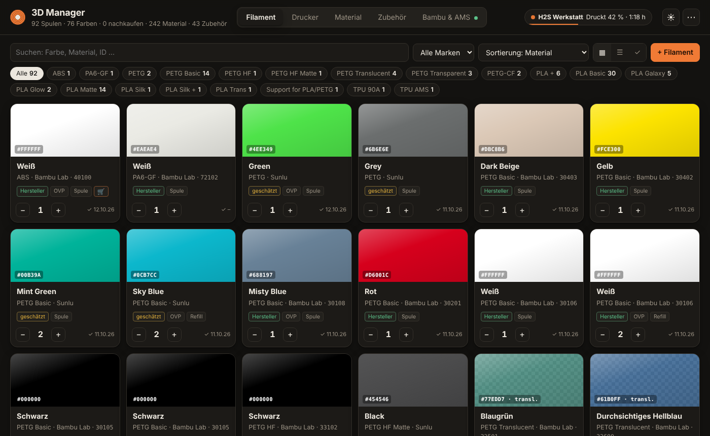
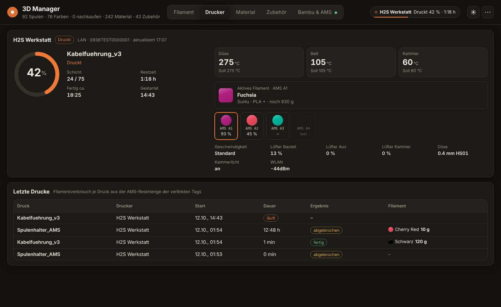
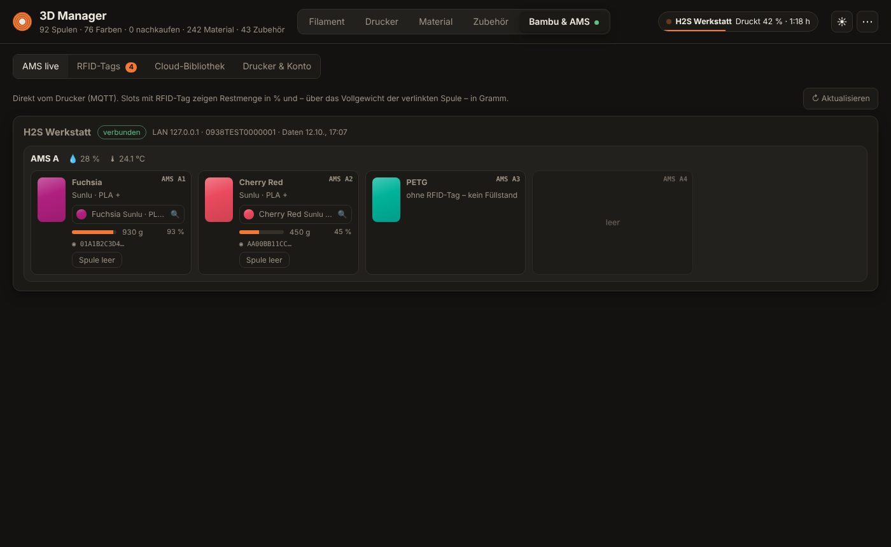
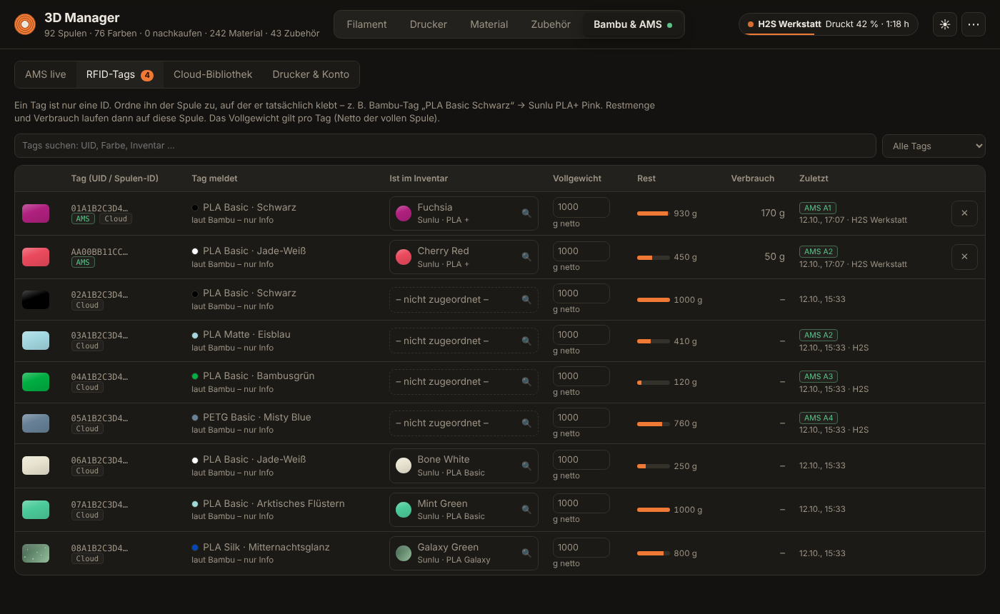
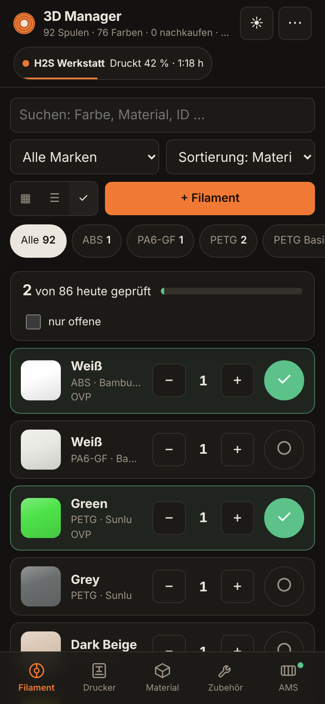
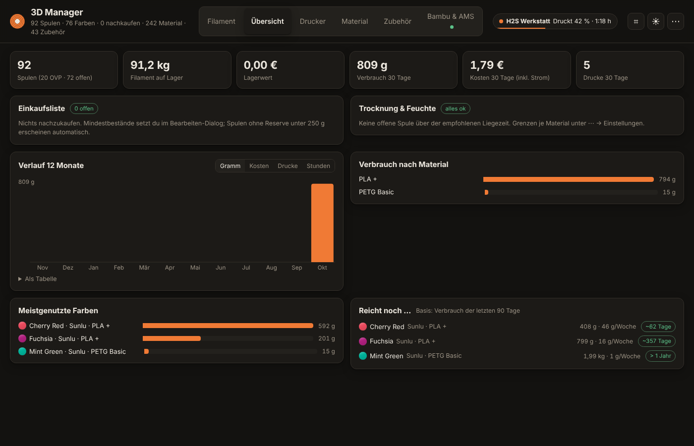
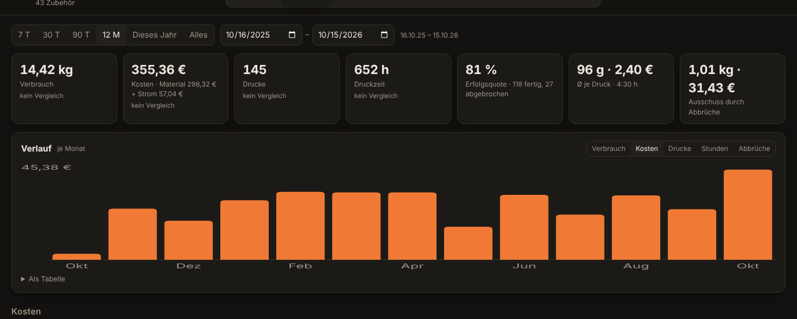

# 3D Manager

Selbst gehostete Web-App für den 3D-Druck im Homelab: **Filament-, Material- und Zubehörbestand**, **Bambu Lab AMS live**, **RFID-Tags** (auch auf Fremdhersteller-Spulen) und **Druckerstatus** – in einem Docker-Container, optimiert für Desktop und Handy.



## Funktionen

**Inventar**
- Filament mit **Farbmuster pro Spule** – offizielle Bambu-Farbwerte (über die 5-stellige Bambu-ID), Community-Farbwerte für Sunlu, Anycubic, Polymaker, eSun u. v. m., Verläufe, Transparenz, Matt/Silk/Galaxy-Optik, eigenes Foto vom gedruckten Muster
- Kacheln, **sortierbare Tabelle** und **Inventur-Modus** (große Zeilen, „heute geprüft“, Fortschritt)
- **Massenbearbeitung:** mehrere Filamente auswählen (oder „Alle angezeigten“ nach Suche/Filter) → Preis, Gewicht, Lagerort, Links, Druck-/Trocknungsprofil usw. in einem Schritt setzen
- OVP / Spule / Refill / Muster, Lagerort, Mindestbestand („nachkaufen“), Restgewicht, Notizen
- Reiter **Material** (Holz, Acryl, Vinyl …) und **Zubehör** (Düsen, Druckplatten, Magnete …)
- Pro Eintrag **Hersteller**, **Hersteller-Link** und **Bezugsquelle (Shop-Link)** – 🛒 direkt in der Liste
- Export als JSON-Backup und CSV (Excel), Import des Backups

**Bambu Lab**
- **AMS live per MQTT** (LAN mit Zugangscode oder über die Bambu-Cloud): Slots, Restmenge, AMS-Feuchte/-Temperatur, AMS HT und externe Spule
- **RFID-Tags frei zuordnen**: Ein Tag ist nur eine ID – ein umgesetzter Bambu-Tag „PLA Basic Schwarz“ kann z. B. für eine Sunlu PLA+ Pink stehen. Restmenge und Verbrauch laufen dann auf diese Spule. Zuordnung per **Volltextsuche**
- **Bambu Filament Manager** (Cloud-Spulenbibliothek von Bambu Studio/Handy) wird gelesen und mit den AMS-Tags zusammengeführt
- **Druckerstatus**: Fortschritt, Schicht, Restzeit, Fertig-Uhrzeit, Temperaturen (Düse/Bett/Kammer), aktives Filament, Lüfter, HMS-Fehler im Klartext (deutsch)
- **Grammgenauer Verbrauch** je Druck aus den Bambu-Cloud-Druckaufträgen (Slicer-Gramm pro AMS-Slot) – korrigiert die AMS-Schätzung, abgebrochene Drucke anteilig; Slots ohne Tag per Klick einer Spule zuordnen
- **Druckhistorie** mit Verbrauch und Kosten je Druck
- **Bambu Studio zeigt das richtige Fremdfilament:** Liegt eine Spule mit umgesetztem Bambu-Tag im AMS, meldet der 3D Manager dem Drucker das passende Profil (eigenes Cloud-Profil oder Systemprofil wie „SUNLU PLA+“), die Inventarfarbe und die Düsentemperatur. Ob der Drucker die Werte übernimmt, wird geprüft und am Slot angezeigt (✓ / ⚠)

**Spulen, Kosten & Planung**
- **Einzelne Spulen** (S0001 …) statt nur Stückzahl: Status OVP/offen/leer, Restgewicht, Öffnungs- und Trocknungsdatum, Preis, Lagerort; RFID-Tag hängt an der konkreten Spule
- **Wiegen** mit Tara (Leerspule wird je Sorte gemerkt)
- **Kosten**: Preis je Spule/kg, Kosten je Druck (Material + Strom), Lagerwert
- **Übersicht**: Einkaufsliste (Mindestbestand/fast leer, gruppiert nach Shop, „bestellt“-Markierung), Trocknungs-Hinweise (offene Liegezeit je Material, AMS-Feuchte), Verbrauch 12 Monate, nach Material, Top-Farben, „Reicht noch …“-Prognose
- **Statistik** (eigener Reiter, Zeitraum frei wählbar, Vergleich zum Vorzeitraum): Verbrauch, Kosten (Material/Strom/Ausschuss), Erfolgsquote, Ø je Druck, teuerste/längste/abgebrochene Drucke, Kosten nach Material und Marke, Auslastung je Drucker, Heatmap Wochentag × Uhrzeit, Verbrauch je AMS-Slot, Lagerwert je Marke, Ladenhüter
- **Materialprofile**: Düsen-/Betttemperatur, Trocknung, max. offene Tage je Familie (PLA, PETG, ABS …) mit Überschreibung pro Sorte
- **QR-Etiketten** (A4-Bögen 3×8 / 2×7, Etikettenrollen 62×29 / 50×30) und **Scanner** im Browser – Scan öffnet die Spule, Inventur per Scan
- **Automatische Backups** (täglich, Aufbewahrung einstellbar, Download in den Einstellungen)

**Bedienung**
- Dark Mode (Standard), Hell, System
- Handy: Navigation unten, Karten statt Tabellen, große Touch-Ziele, Dialoge als Sheet
- Installierbar als App (PWA) mit Kurzbefehlen

| Druckerstatus | AMS live | RFID-Tags | Handy |
|---|---|---|---|
|  |  |  |  |




## Installation

Voraussetzung: Docker mit Compose.

```bash
git clone https://github.com/Qu3ntyn83/3D-Manager.git
cd 3D-Manager
docker compose pull      # fertiges Image von ghcr.io (amd64/arm64)
docker compose up -d     # oder selbst bauen: docker compose up -d --build
```

Danach erreichbar unter `http://<docker-host>:8095`.

- Daten liegen in `./data` (`inventar.db` + `uploads/` für Fotos).
- **Backups**: täglich um 3 Uhr nach `./data/backups` (14 Tage, mind. 3 Stück) – Zeit/Aufbewahrung unter ⋯ → Einstellungen. Ziel per `BACKUP_DIR` z. B. auf ein NAS legen. Wiederherstellen: Container stoppen, Archiv in `./data` entpacken, starten.
- Der Bambu-Farbkatalog (AGPL) ist nicht im Repository; er wird beim Build bzw. beim ersten Start von GitHub geladen.
- **Kamera-Scanner** braucht HTTPS (Reverse Proxy) – unter `http://` geht nur die Eingabe des Codes von Hand. Für die QR-Etiketten unter Einstellungen die öffentliche Adresse eintragen.
- `SEED=1` in der `docker-compose.yml` füllt eine leere Datenbank beim ersten Start mit einem Beispiel-Inventar.
- `BAMBU_MOCK=/app/mock_spools.json` zeigt Beispiel-Spulen der Cloud-Bibliothek ohne Bambu-Account.

**Umstieg vom alten Paket „3D Management“** (Daten, Fotos, RFID-Zuordnungen und DNS-Einstellung werden übernommen, das alte Verzeichnis bleibt als Rückweg liegen):

```bash
curl -fsSL https://raw.githubusercontent.com/Qu3ntyn83/3D-Manager/main/scripts/migrate-from-3d-management.sh -o migrate.sh
sudo bash migrate.sh
```

**Update**

```bash
git pull
docker compose pull && docker compose up -d    # bzw. docker compose up -d --build
```

Neue Datenbankfelder werden beim Start automatisch angelegt; vorhandene Daten bleiben erhalten. Beim ersten Start mit Spulen-Verwaltung werden aus der Stückzahl automatisch einzelne Spulen erzeugt.

## Drucker verbinden

**Bambu & AMS → Drucker & Konto → + Drucker**

| Modus | Benötigt | Hinweis |
|---|---|---|
| **LAN** (empfohlen) | IP, Seriennummer, 8-stelliger LAN-Zugangscode (Druckerdisplay → Einstellungen → Netzwerk) | MQTT/TLS auf Port 8883, ohne Internet. Wird die Verbindung abgelehnt, am Drucker LAN-Modus bzw. Entwicklermodus prüfen. |
| **Cloud** | Anmeldung mit dem Bambu-Account (s. u.) | „Aus Bambu-Account übernehmen“ legt alle Drucker des Kontos an. |

Die App hält pro Drucker eine MQTT-Verbindung, fordert alle 5 Minuten einen Vollstatus an und verarbeitet die laufenden Delta-Meldungen.

## Bambu-Account / Filament Manager

**Bambu & AMS → Drucker & Konto**: E-Mail + Passwort (Bambu schickt meist einen Code per Mail), 2FA wird unterstützt. Konten, die über **Google/Apple** angelegt wurden, haben kein Passwort → **„Code per Mail“** verwenden. Alternativ ein vorhandenes Token einfügen.

- Gespeichert wird nur das Token (ca. 90 Tage gültig), nicht das Passwort.
- „Verbindung zur Bambu-Cloud testen“ prüft curl_cffi, DNS und HTTPS – bei `Could not resolve host` dem Container einen DNS-Server geben (siehe `dns:` in der `docker-compose.yml`) oder global in `/etc/docker/daemon.json`.
- Es wird **nur gelesen**, nichts in die Cloud geschrieben.

## RFID-Tags

Ein Tag ist nur eine ID. Was Bambu über den Tag meldet (Material/Farbe), wird nur als Info angezeigt.

- **RFID-Tags** listet alle Tags – aus dem AMS (MQTT) und aus der Bambu-Cloud – in einer Liste. Jeder Tag lässt sich per Suche **jeder** Inventar-Spule zuordnen; ebenso direkt im AMS-Slot oder im Bearbeiten-Dialog einer Spule (dort auch „umhängen“).
- **Restgewicht** = Restmenge % (AMS-Schätzung) × **Vollgewicht** des Tags (netto, Standard 1000 g, pro Tag änderbar).
- **Verbrauch** wird mitprotokolliert (nur Abnahmen), auch je Druck in der Druckhistorie.
- **„Spule leer“** im AMS-Slot: Bestand −1 und Tag freigeben, um ihn der nächsten Spule zuzuordnen.
- Voraussetzung für Füllstände: AMS-Option „Restmenge schätzen“ aktiv. Spulen ohne Tag liefern keinen Füllstand.
- Optional: „neue Original-Bambu-Spulen nach Bambu-Angabe zuordnen“ (Standard aus).

## Android-App mit NFC

Handy-Browser können Bambu-Tags (MIFARE Classic) nicht lesen. Dafür gibt es die kleine **Android-App** (`android/`): Sie zeigt die normale Oberfläche und liest den Tag, sobald eine Spule ans Handy gehalten wird – auch wenn die App geschlossen ist.

- **Download:** [3D-Manager.apk](https://github.com/Qu3ntyn83/3D-Manager/releases/download/android/3D-Manager.apk) (oder im Browser auf dem Handy unter ⋯ → „Android-App mit NFC laden“). Beim ersten Start die Adresse des 3D Manager eingeben, z. B. `http://192.168.178.42:8095`.
- **Was gelesen wird:** immer die UID. Handys mit NXP-NFC-Chip (z. B. Pixel, viele Xiaomi/OnePlus) lesen zusätzlich die Bambu-Daten – Spulen-ID, Material, Farbe, Gewicht, Temperaturen, Produktionsdatum. Viele Samsung-Geräte unterstützen MIFARE Classic nicht; dort reicht die UID für die Zuordnung, Material/Farbe ergänzt das AMS.
- **Ablauf:** Tag unbekannt → wird angelegt und lässt sich einer Inventar-Spule zuordnen. Tag bekannt → zeigt die Spule mit Restmenge, „Spule öffnen“. Bei offenem Scanner (⌗) mit „Inventur“ zählt der NFC-Scan wie ein QR-Code. Sieht das AMS den Tag später, werden beide Einträge automatisch zusammengeführt.
- **Build:** GitHub Actions baut die APK bei Änderungen unter `android/` und legt sie im Release `android` ab. Für eine gleichbleibende Signatur (Updates ohne Neuinstallation) die Secrets `ANDROID_KEYSTORE_BASE64` und `ANDROID_KEYSTORE_PASSWORD` setzen.

## Handy & App-Installation

- Volle PWA (Installieren-Knopf, Offline-Oberfläche) benötigt **HTTPS**, z. B. hinter einem Reverse Proxy (Caddy, Traefik, Nginx Proxy Manager).
- Über `http://IP:8095` funktioniert „Zum Home-Bildschirm hinzufügen“ ebenfalls, nur ohne Offline-Cache.
- Kurzbefehle: `/?tab=printer`, `/?tab=bambu`, `/?tab=filaments&view=check` (Inventur).

## Sicherheit

- Es gibt **keine Anmeldung** in der App → nur im LAN betreiben oder hinter einem Reverse Proxy mit Authentifizierung (Authelia, Authentik, Keycloak …).
- Bambu-Token und LAN-Zugangscodes liegen im Klartext in `data/inventar.db` → Verzeichnis entsprechend schützen.

## API (Auszug)

| Methode | Pfad | Zweck |
|---|---|---|
| GET/POST | `/api/filaments` | Filament lesen/anlegen |
| GET/PUT/PATCH/DELETE | `/api/filaments/<id>` | einzelne Spule |
| POST | `/api/filaments/<id>/adjust` | Bestand ändern `{"delta": -1}` |
| GET/POST | `/api/materials` | Material & Zubehör (`kind`: `material`/`zubehoer`) |
| GET | `/api/ams/status` | Druckerstatus aller Drucker |
| GET | `/api/ams/live` | AMS-Slots inkl. zugeordneter Spulen |
| GET | `/api/ams/rfid` | alle RFID-Tags (AMS + Cloud) |
| POST | `/api/ams/rfid/<tag>/link` | Tag zuordnen `{"filament_id": 12}` |
| GET | `/api/ams/jobs` | Druckhistorie mit Verbrauch und Kosten |
| GET/POST | `/api/units` | einzelne Spulen |
| POST | `/api/units/<id>/weigh` | wiegen `{"gross_g": 812, "tare_g": 250}` |
| POST | `/api/units/<id>/open`, `/empty`, `/dry` | Spule öffnen / leer / getrocknet |
| POST | `/api/jobs/<id>/assign` | Slicer-Gramm eines Slots ohne Tag zuordnen |
| GET | `/api/stats`, `/api/shopping`, `/api/drying` | Kurzstatistik, Einkaufsliste, Trocknung |
| GET | `/api/stats/full?range=90d` bzw. `?from=…&to=…` | Erweiterte Statistik |
| GET/PUT | `/api/settings`, `/api/profiles` | Einstellungen, Materialprofile |
| GET/POST | `/api/backups` | Backups auflisten / jetzt sichern |
| GET | `/api/export`, `/api/export.csv?kind=filaments` | Backup / CSV |

Damit lassen sich z. B. in Home Assistant per `rest`-Sensor Bestand, AMS-Belegung und Druckerstatus anzeigen.

## Technik

Python 3.12 · Flask · SQLite · gunicorn (1 Worker, Threads) · paho-mqtt · curl_cffi · Vanilla JS/CSS ohne Build-Schritt.

```
app/
  app.py              Inventar-API, Export/Import, Migrationen
  ams.py              MQTT-Verbindungen, AMS-Slots, RFID-Tags, Druckhistorie
  printer_status.py   Status-Dekodierung, HMS-Texte, Job-Tracking
  bambu.py            Bambu-Cloud: Login, Filament-Manager-Sync
  bambu_cloud.py      HTTP-Client für die Bambu-Cloud
  tasks.py            Druckaufträge aus der Cloud, Slicer-Gramm buchen
  units.py            einzelne Spulen, Verbrauchsprotokoll
  insights.py         Einstellungen, Kosten, Profile, Einkaufsliste, Statistik
  backup.py           automatische Backups
  catalog_fetch.py    Bambu-Farbkatalog laden
  catalog/            Farbkataloge (Bambu, Community)
  hms/                HMS-Fehlertexte (de/en)
  static/             Oberfläche, PWA
tests/                pytest (läuft in GitHub Actions)
```

Tests lokal: `pip install -r requirements.txt pytest && python -m pytest -q tests`. GitHub Actions testet jeden Push/PR und baut bei `main` und Tags `v*` das Image `ghcr.io/qu3ntyn83/3d-manager`.

## Haftungsausschluss

Die Bambu-Cloud-Schnittstelle ist inoffiziell (dieselbe, die Bambu Studio nutzt) und kann sich jederzeit ändern. Dieses Projekt ist nicht mit Bambu Lab verbunden. Quellen und Lizenzen der enthaltenen Daten: [THIRD_PARTY.md](THIRD_PARTY.md).

## Autor

**[Qu3ntyn83](https://github.com/Qu3ntyn83)** – Idee, Anforderungen und Test im eigenen Homelab (Bambu Lab H2S mit AMS 2 Pro).

## Lizenz

[MIT](LICENSE) – ausgenommen die in [THIRD_PARTY.md](THIRD_PARTY.md) genannten Dateien.
